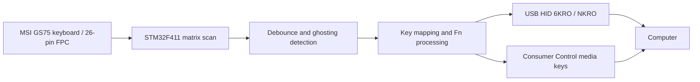

# MSI GS75 Keyboard — STM32 USB HID Firmware

Custom firmware for an **STM32F411RET6-based USB adapter** that allows the keyboard from an MSI GS75 laptop to be used as a standalone USB keyboard.

The project covers **keyboard matrix scanning, key processing, USB HID and firmware diagnostics**. It is based on a measured key matrix rather than the original laptop's keyboard controller.

> **Board Rev.2 diagnostic baseline:** firmware adaptation is implemented, 151 host tests and the engineering audit are complete, and clean ARM builds pass. Board Rev.2 has **not** been hardware-tested; assembly status is not established by the sources in this repository. Earlier matrix and core USB results were obtained on the previous adapter board. Do not treat this baseline as a validated Rev.2 firmware release.

## Features

- **STM32F411RET6** microcontroller (USB Full Speed device).
- **26-pin keyboard FPC** connected to a custom adapter PCB.
- Measured **8 × 18 matrix**, with **102 mapped keys**.
- **1 kHz matrix scanning** with **5 ms per-key debounce**.
- **Ghosting detection** and conservative suppression of newly ambiguous keys (ghosting has been observed in the measured matrix).
- USB HID keyboard supporting **Boot Protocol (6KRO)** and **Report Protocol (NKRO)**.
- Separate **Consumer Control** HID interface for media keys (implemented in firmware; revised-board validation pending).
- **Fn-layer mappings** for navigation and selected multimedia functions.
- UART diagnostics for matrix state, ghosting, key state, USB status and timing.
- Host-side automated tests and captured matrix/ghosting measurements.

## How it works



The firmware scans the measured keyboard matrix, debounces each coordinate, and derives a logical key state. If an electrical rectangle makes some key presses ambiguous, the firmware conservatively avoids accepting *new* ambiguous presses. This avoids fabricating phantom key events, but it cannot fully resolve ghosting inherent in the physical matrix.

The accepted logical state is translated into USB HID reports. Time-sensitive scanning is kept separate from main-loop USB transmission and UART formatting.

## Hardware

| Component | Description |
| --- | --- |
| Keyboard | MSI GS75 laptop keyboard |
| Controller | STM32F411RET6 |
| Keyboard connection | 26-pin FPC |
| Matrix | 8 drive rows × 18 sense columns |
| PC connection | USB Full Speed (USB HID) |
| Programming/debugging | SWD / ST-LINK |
| Diagnostics | USART1 UART, 115200 baud, 8N1 |

**Hardware revision note:** The 8 × 18 keyboard matrix and FPC map were measured on the earlier adapter. Rev.2 power GPIO/ADC assignments are implemented from the available schematic, but the physical connections and keyboard behavior on Rev.2 remain unverified. Check the actual board against the matching schematic before any later flashing or connection.

Current firmware details and the earlier pin mapping are recorded in [`CODEX_CONTEXT.md`](CODEX_CONTEXT.md) and [`docs/MATRIX_RUNTIME.md`](docs/MATRIX_RUNTIME.md).

## USB HID

The current firmware implements two USB HID interfaces:

| Interface | Purpose | Reports |
| --- | --- | --- |
| Keyboard | Standard keyboard input | 8-byte Boot 6KRO / 22-byte Report NKRO |
| Consumer Control | Volume and mute controls | Separate media-key report |

Implemented Fn mappings include navigation functions and volume/mute shortcuts. See [`docs/USB_HID.md`](docs/USB_HID.md) for HID descriptors, key combinations, protocol behavior, configuration and test procedures.

**USB VID/PID:** The existing development configuration uses ST example identifiers (`0483:5710`), which are **not assigned to this project**. Use appropriately authorized identifiers before distributing a USB product.

## Repository layout

| Path | Contents |
| --- | --- |
| `Core/` | Application firmware and keyboard logic |
| `Drivers/` | STM32 HAL/CMSIS components |
| `Middlewares/ST/` | STM32 USB Device middleware |
| `docs/` | Matrix/HID documentation, Rev.2 audit and hardware test plan |
| `hardware/schematics/` | Available Rev.2 schematic export |
| `tests/` | Host-side regression tests |
| `tools/matrix_mapper/` | Matrix mapping tools and captured experimental data |
| `GS75_Keyboard.ioc` | STM32CubeMX configuration |
| `CMakeLists.txt`, `CMakePresets.json` | CMake project/build configuration |

## Build and development

The firmware project uses **STM32CubeMX**, **CMake**, **Ninja** and the **Arm GNU Toolchain**. It has been built using STM32CubeCLT and VS Code with CMake Tools.

1. Clone the repository:

   ```bash
   git clone https://github.com/AlexeyNV/GS75_Keyboard.git
   cd GS75_Keyboard
   ```

2. Install the Arm embedded build toolchain, CMake and Ninja (or use STM32CubeCLT).
3. Open the project in VS Code, select the CMake preset from `CMakePresets.json`, configure and build.
4. For later physical tests, verify the board revision and BOM first, then follow the diagnostic-only first-power procedure before connecting the keyboard or any RGB hardware.

Detailed USB/HID build and hardware-check notes are in [`docs/USB_HID.md`](docs/USB_HID.md). The current source tree is a diagnostic baseline, **not a hardware-validated Rev.2 firmware release**.

## Testing and validation

The development history records the following results on the **earlier adapter hardware**:

- Matrix scanning measured at **1000 Hz**, with scan execution around **233–237 µs** in the documented tests.
- All **102 mapped single keys** captured consistently during matrix discovery.
- Ghosting behavior characterized using captured multi-key combinations.
- Core USB keyboard operation verified on physical hardware.
- A documented set of **104 host-side tests** passed for the firmware changes covering the added Consumer Control interface; **hardware verification of those additions was still pending**.

These results describe the earlier firmware/hardware stage and **are not Rev.2 acceptance results**.

Further technical details: [`docs/MATRIX_RUNTIME.md`](docs/MATRIX_RUNTIME.md), [`docs/KEYBOARD_STATE.md`](docs/KEYBOARD_STATE.md), [`docs/USB_HID.md`](docs/USB_HID.md) and [`docs/HID_KEYMAP.csv`](docs/HID_KEYMAP.csv).

## Board Rev.2 power management (2026-10-22)

Implemented, host-tested and independently audited: TUSB320 GPIO attach/current
diagnostics, INA180A1 ADC current monitoring, TPS2553 software fault latch and
explicit bench commands. Rev.2 hardware testing has not begun.

**Hardware validation is pending.** Normal Rev2Debug builds keep +5V_RGB OFF;
Rev2Bench additionally requires a verified-hardware acknowledgement before explicit
PWRON. LegacyDebug preserves old-board compatibility. U13 A1/A3 BOM inconsistency
must be resolved on any assembled board before power testing. RGB SPI/PWM/LED
control is not implemented.

- [Hardware connections and review](docs/HARDWARE_REV2.md)
- [Power policy, UART commands and build presets](docs/POWER_MANAGEMENT.md)
- [Exact manual bench procedure and acceptance evidence](docs/POWER_TEST_PLAN.md)
- [Blank hardware measurement record](docs/POWER_TEST_RECORD.md)

151 host tests in seven CTest suites pass; ARM clean builds pass without warnings or
errors. These results do not validate electrical behavior or ADC accuracy.

The Rev.2 power audit caps the firmware's effective budget to the current
descriptor's 100mA in all Type-C modes and documents the absence of a
hardware OFF mechanism for a fully hung MCU. See [audit findings](docs/POWER_AUDIT.md)
before board tests.

Future board measurements include USB suspend current and a separate feasibility
study for USB 2.0 High-Power 500mA; no descriptor or firmware change is part of
this baseline.

## Next steps

- [ ] Confirm the actual Rev.2 PCB assembly and BOM, especially the INA180A1/A3 discrepancy, before applying power.
- [ ] Run diagnostic-only Rev2Debug first-power checks with RGB disconnected; measure PC9, USB power, ADC and CC behavior using the blank hardware test record.
- [ ] Measure total USB current during suspend, current-sensor accuracy at two known loads and fault-to-EN shutdown latency.
- [ ] Repeat matrix, ghosting, Boot/NKRO, Fn and Consumer Control tests on Rev.2 hardware and publish measured results.
- [ ] Investigate a separate USB 2.0 High-Power 500mA revision only after the current 100mA configuration is validated; keep RGB controller work separate.

## Scope

This repository is **only for the standalone USB keyboard firmware** and its supporting matrix-mapping/diagnostic resources. The **RGB backlight FPC pinout scanner** is a separate hardware/firmware project and is intentionally not included here.

## Author

**AlexeyNV** — [GitHub profile](https://github.com/AlexeyNV)
