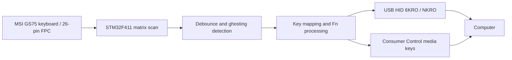

# MSI GS75 Keyboard — STM32 USB HID Firmware

Custom firmware for an **STM32F411RET6-based USB adapter** that allows the keyboard from an MSI GS75 laptop to be used as a standalone USB keyboard.

The project covers **keyboard matrix scanning, key processing, USB HID and firmware diagnostics**. It is based on a measured key matrix rather than the original laptop's keyboard controller.

> **Project status: active development.** The previous adapter board was used to validate matrix scanning and the core USB keyboard functionality. A revised PCB has since been assembled; its pin mapping, firmware adaptation and hardware validation are the next steps. The current `main` branch must **not** be assumed to be ready for the new PCB.

## Features

- **STM32F411RET6** microcontroller (USB Full Speed device).
- **26-pin keyboard FPC** connected to a custom adapter PCB.
- Measured **8 × 18 matrix**, with **102 mapped keys**.
- **1 kHz matrix scanning** with **5 ms per-key debounce**.
- **Ghosting detection** and conservative suppression of newly ambiguous keys (ghosting has been observed in the measured matrix).
- USB HID keyboard supporting **Boot Protocol (6KRO)** and **Report Protocol (NKRO)**.
- Separate **Consumer Control** HID interface for media keys (implemented in firmware; revised-board validation pending).
- **Fn-layer mappings** for navigation and selected multimedia functions.
- UART diagnostics for matrix state, ghosting, key state, USB status and timing.
- Host-side automated tests and captured matrix/ghosting measurements.

## How it works



The firmware scans the measured keyboard matrix, debounces each coordinate, and derives a logical key state. If an electrical rectangle makes some key presses ambiguous, the firmware conservatively avoids accepting *new* ambiguous presses. This avoids fabricating phantom key events, but it cannot fully resolve ghosting inherent in the physical matrix.

The accepted logical state is translated into USB HID reports. Time-sensitive scanning is kept separate from main-loop USB transmission and UART formatting.

## Hardware

| Component | Description |
| --- | --- |
| Keyboard | MSI GS75 laptop keyboard |
| Controller | STM32F411RET6 |
| Keyboard connection | 26-pin FPC |
| Matrix | 8 drive rows × 18 sense columns |
| PC connection | USB Full Speed (USB HID) |
| Programming/debugging | SWD / ST-LINK |
| Diagnostics | USART1 UART, 115200 baud, 8N1 |

**Hardware revision note:** The GPIO/FPC wiring in the current firmware documentation refers to the previously tested adapter board. It may change as support for the newly assembled PCB is introduced. Always check the PCB schematic and the firmware configuration for the *same hardware revision* before flashing.

Current firmware details and the earlier pin mapping are recorded in [`CODEX_CONTEXT.md`](CODEX_CONTEXT.md) and [`docs/MATRIX_RUNTIME.md`](docs/MATRIX_RUNTIME.md).

## USB HID

The current firmware implements two USB HID interfaces:

| Interface | Purpose | Reports |
| --- | --- | --- |
| Keyboard | Standard keyboard input | 8-byte Boot 6KRO / 22-byte Report NKRO |
| Consumer Control | Volume and mute controls | Separate media-key report |

Implemented Fn mappings include navigation functions and volume/mute shortcuts. See [`docs/USB_HID.md`](docs/USB_HID.md) for HID descriptors, key combinations, protocol behavior, configuration and test procedures.

**USB VID/PID:** The existing development configuration uses ST example identifiers (`0483:5710`), which are **not assigned to this project**. Use appropriately authorized identifiers before distributing a USB product.

## Repository layout

| Path | Contents |
| --- | --- |
| `Core/` | Application firmware and keyboard logic |
| `Drivers/` | STM32 HAL/CMSIS components |
| `Middlewares/ST/` | STM32 USB Device middleware |
| `docs/` | Matrix runtime, keyboard state, USB HID and keymap documentation |
| `tests/` | Host-side regression tests |
| `tools/matrix_mapper/` | Matrix mapping tools and captured experimental data |
| `GS75_Keyboard.ioc` | STM32CubeMX configuration |
| `CMakeLists.txt`, `CMakePresets.json` | CMake project/build configuration |

## Build and development

The firmware project uses **STM32CubeMX**, **CMake**, **Ninja** and the **Arm GNU Toolchain**. It has been built using STM32CubeCLT and VS Code with CMake Tools.

1. Clone the repository:

   ```bash
   git clone https://github.com/AlexeyNV/GS75_Keyboard.git
   cd GS75_Keyboard
   ```

2. Install the Arm embedded build toolchain, CMake and Ninja (or use STM32CubeCLT).
3. Open the project in VS Code, select the CMake preset from `CMakePresets.json`, configure and build.
4. Program a **compatible PCB revision** with ST-LINK over SWD. Confirm the actual FPC-to-GPIO mapping before connecting the laptop keyboard or running the firmware.

Detailed USB/HID build and hardware-check notes are in [`docs/USB_HID.md`](docs/USB_HID.md). The current source tree is a development snapshot, **not a validated firmware release for the new PCB**.

## Testing and validation

The development history records the following results on the **earlier adapter hardware**:

- Matrix scanning measured at **1000 Hz**, with scan execution around **233–237 µs** in the documented tests.
- All **102 mapped single keys** captured consistently during matrix discovery.
- Ghosting behavior characterized using captured multi-key combinations.
- Core USB keyboard operation verified on physical hardware.
- A documented set of **104 host-side tests** passed for the firmware changes covering the added Consumer Control interface; **hardware verification of those additions was still pending**.

These results describe the tested firmware/hardware stage and **must not be read as acceptance test results for the newly assembled PCB**.

Further technical details: [`docs/MATRIX_RUNTIME.md`](docs/MATRIX_RUNTIME.md), [`docs/KEYBOARD_STATE.md`](docs/KEYBOARD_STATE.md), [`docs/USB_HID.md`](docs/USB_HID.md) and [`docs/HID_KEYMAP.csv`](docs/HID_KEYMAP.csv).

## Next steps

- [ ] Update board-specific GPIO configuration for the revised PCB.
- [ ] Verify power, SWD, UART and USB operation on the assembled board.
- [ ] Repeat matrix/keymap and ghosting checks on the new hardware.
- [ ] Verify keyboard, NKRO/6KRO, Fn and Consumer Control behavior on a host PC.
- [ ] Publish updated PCB photographs, validated firmware status and reproducible test results.

## Scope

This repository is **only for the standalone USB keyboard firmware** and its supporting matrix-mapping/diagnostic resources. The **RGB backlight FPC pinout scanner** is a separate hardware/firmware project and is intentionally not included here.

## Author

**AlexeyNV** — [GitHub profile](https://github.com/AlexeyNV)
