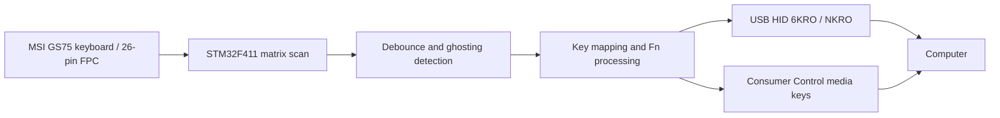

# MSI GS75 Keyboard — STM32 USB HID Firmware

Custom firmware for an **STM32F411RET6-based USB adapter** that allows the keyboard from an MSI GS75 laptop to be used as a standalone USB keyboard.

The project covers **keyboard matrix scanning, key processing, USB HID and firmware diagnostics**. It is based on a measured key matrix rather than the original laptop's keyboard controller.

> **Board Rev.2 keyboard prototype:** the core USB-keyboard firmware is implemented and Board Rev.2 has completed initial user-run hardware bring-up. USB keyboard and Consumer Control, all 102 keys, confirmed Fn shortcuts, ghost diagnostics and the Rev2Debug power readback work on the board. The 151 host tests and independent power audit also pass. RGB is not implemented, and power switching, current accuracy, suspend consumption and protection timing remain unvalidated.

## Features

- **STM32F411RET6** microcontroller (USB Full Speed device).
- **26-pin keyboard FPC** connected to a custom adapter PCB.
- Measured **8 × 18 matrix**, with **102 mapped keys**.
- **1 kHz matrix scanning** with **5 ms per-key debounce**.
- **Ghosting detection** and conservative suppression of newly ambiguous keys (ghosting has been observed in the measured matrix).
- USB HID keyboard supporting **Boot Protocol (6KRO)** and **Report Protocol (NKRO)**.
- Separate **Consumer Control** HID interface for media keys (user-observed working on Rev.2).
- **Fn-layer mappings** for navigation and selected multimedia functions.
- UART diagnostics for matrix state, ghosting, key state, USB status and timing.
- Host-side automated tests and captured matrix/ghosting measurements.

## How it works



The firmware scans the measured keyboard matrix, debounces each coordinate, and derives a logical key state. If an electrical rectangle makes some key presses ambiguous, the firmware conservatively avoids accepting *new* ambiguous presses. This avoids fabricating phantom key events, but it cannot fully resolve ghosting inherent in the physical matrix.

The accepted logical state is translated into USB HID reports. Time-sensitive scanning is kept separate from main-loop USB transmission and UART formatting.

## Hardware

| Component | Description |
| --- | --- |
| Keyboard | MSI GS75 laptop keyboard |
| Controller | STM32F411RET6 |
| Keyboard connection | 26-pin FPC |
| Matrix | 8 drive rows × 18 sense columns |
| PC connection | USB Full Speed (USB HID) |
| Programming/debugging | SWD / ST-LINK |
| Diagnostics | USART1 UART, 115200 baud, 8N1 |

**Hardware revision note:** The 8 × 18 matrix map originated on the earlier adapter and all keys were subsequently checked by the user on the built Rev.2 board. Rev.2 power GPIO/ADC assignments follow the available schematic; only the steady diagnostic readings listed in the [bring-up record](docs/POWER_TEST_RECORD.md) have been checked on hardware. Further power tests require the matching board and schematic.

Current firmware details and the earlier pin mapping are recorded in [`CODEX_CONTEXT.md`](CODEX_CONTEXT.md) and [`docs/MATRIX_RUNTIME.md`](docs/MATRIX_RUNTIME.md).

## USB HID

The current firmware implements two USB HID interfaces:

| Interface | Purpose | Reports |
| --- | --- | --- |
| Keyboard | Standard keyboard input | 8-byte Boot 6KRO / 22-byte Report NKRO |
| Consumer Control | Volume and mute controls | Separate media-key report |

Implemented Fn mappings include navigation functions and volume/mute shortcuts. See [`docs/USB_HID.md`](docs/USB_HID.md) for HID descriptors, key combinations, protocol behavior, configuration and test procedures.

**USB VID/PID:** The existing development configuration uses ST example identifiers (`0483:5710`), which are **not assigned to this project**. Use appropriately authorized identifiers before distributing a USB product.

## Repository layout

| Path | Contents |
| --- | --- |
| `Core/` | Application firmware and keyboard logic |
| `Drivers/` | STM32 HAL/CMSIS components |
| `Middlewares/ST/` | STM32 USB Device middleware |
| `docs/` | Matrix/HID documentation, Rev.2 audit and hardware test plan |
| `hardware/schematics/` | Available Rev.2 schematic export |
| `tests/` | Host-side regression tests |
| `tools/matrix_mapper/` | Matrix mapping tools and captured experimental data |
| `GS75_Keyboard.ioc` | STM32CubeMX configuration |
| `CMakeLists.txt`, `CMakePresets.json` | CMake project/build configuration |

## Build and development

The firmware project uses **STM32CubeMX**, **CMake**, **Ninja** and the **Arm GNU Toolchain**. It has been built using STM32CubeCLT and VS Code with CMake Tools.

1. Clone the repository:

   ```bash
   git clone https://github.com/AlexeyNV/GS75_Keyboard.git
   cd GS75_Keyboard
   ```

2. Install the Arm embedded build toolchain, CMake and Ninja (or use STM32CubeCLT).
3. Open the project in VS Code, select the CMake preset from `CMakePresets.json`, configure and build.
4. For further power experiments, verify the board revision and BOM and follow the [power test plan](docs/POWER_TEST_PLAN.md); do not connect the RGB controller yet.

Detailed USB/HID build and hardware-check notes are in [`docs/USB_HID.md`](docs/USB_HID.md). The current source tree is a user-tested keyboard prototype, **not a fully validated power/RGB product or certified release**.

## Testing and validation

The development history records the following results on the **earlier adapter hardware**:

- Matrix scanning measured at **1000 Hz**, with scan execution around **233–237 µs** in the documented tests.
- All **102 mapped single keys** captured consistently during matrix discovery.
- Ghosting behavior characterized using captured multi-key combinations.
- Core USB keyboard operation verified on physical hardware.
- A documented set of **104 host-side tests** passed for the firmware changes covering the added Consumer Control interface; **hardware verification of those additions was still pending**.

These are historical results from the earlier adapter. The separate Rev.2 observations below come from the user's first hardware tests.

Further technical details: [`docs/MATRIX_RUNTIME.md`](docs/MATRIX_RUNTIME.md), [`docs/KEYBOARD_STATE.md`](docs/KEYBOARD_STATE.md), [`docs/USB_HID.md`](docs/USB_HID.md) and [`docs/HID_KEYMAP.csv`](docs/HID_KEYMAP.csv).

## Board Rev.2 power management (2026-10-22)

Implemented, host-tested and independently audited: TUSB320 GPIO attach/current
diagnostics, INA180A1 ADC current monitoring, TPS2553 software fault latch and
explicit bench commands. The user built and started Board Rev.2 with Rev2Debug.
Both USB-C orientations enumerated with CC Default; the populated INA180A1 was
confirmed. A multimeter measured 3.29 V at MCU VDD, 29.6 mV at PA3, 0 V at PC9,
3.285 V at FAULT# and 15 mV at +5V_RGB while OFF. Firmware UART reported
CURRENT_MA=29, BUDGET_MA=100 and PWRON=BENCH_DISABLED. These readings do not
calibrate the current monitor or test the TPS2553 under load.

Full power validation remains pending. Rev2Debug keeps +5V_RGB OFF; explicit
bench enable still requires separate hardware checks. LegacyDebug preserves
old-board compatibility. RGB SPI/PWM/LED control is not implemented.

- [Hardware connections and review](docs/HARDWARE_REV2.md)
- [Power policy, UART commands and build presets](docs/POWER_MANAGEMENT.md)
- [Exact manual bench procedure and acceptance evidence](docs/POWER_TEST_PLAN.md)
- [Initial Rev.2 hardware bring-up record and unrun tests](docs/POWER_TEST_RECORD.md)
- [Planned RGB shortcuts (not implemented)](docs/RGB_BACKLIGHT_PLAN.md)

151 host tests in seven CTest suites pass; ARM clean builds pass without warnings
or errors. On Rev.2, the user reported 1000 Hz scanning, 5 ms debounce, all keys
working in key-test.ru, Fn volume/mute/Home/End and a ghost event that clears on
release. USB reported a 22-byte Report-mode keyboard report. Observed diagnostic
maxima were MAX_SCAN_US=501 and MAX_RUNTIME_US=721/717 microseconds. These
observations do not establish worst-case timing or validate the power protections.

The Rev.2 power audit caps the firmware's effective budget to the current
descriptor's 100mA in all Type-C modes and documents the absence of a
hardware OFF mechanism for a fully hung MCU. See [audit findings](docs/POWER_AUDIT.md)
before board tests.

Future board measurements include USB suspend current and a separate feasibility
study for USB 2.0 High-Power 500mA; no descriptor or firmware change is part of
this baseline.

## Next steps

- [ ] Measure total USB input current with an external ammeter, including suspend, and compare the INA180 against two known loads.
- [ ] Check remaining power-path components and run controlled TPS2553 switching, fault/overcurrent and shutdown-latency tests with a dummy load.
- [ ] Complete the USB Boot-mode, SysReq and stress/overlap checks not documented in the first Rev.2 session.
- [ ] Investigate a separate USB 2.0 High-Power 500mA revision only after the current 100mA configuration is validated.
- [ ] Validate the separate RGB controller/protocol before considering the [planned backlight shortcuts](docs/RGB_BACKLIGHT_PLAN.md).

## Scope

This repository is **only for the standalone USB keyboard firmware** and its supporting matrix-mapping/diagnostic resources. The **RGB backlight FPC pinout scanner** is a separate hardware/firmware project and is intentionally not included here.

## Author

**AlexeyNV** — [GitHub profile](https://github.com/AlexeyNV)
